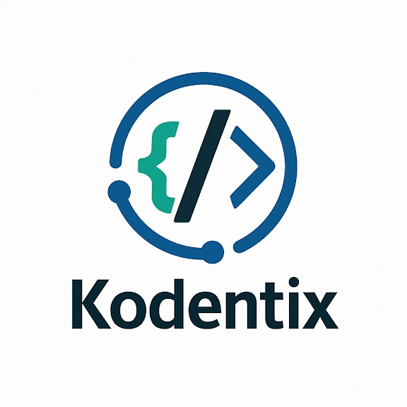
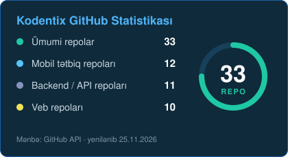
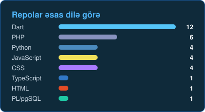

# Salam 👋, biz Kodentix-ik

### Web dünyasına bir addım

**Müasir veb saytlar, mobil tətbiqlər və süni intellekt dəstəkli həllər hazırlayan yazılım şirkəti**

A software company building modern websites, mobile apps and AI-powered solutions.

 

## 🏢 Haqqımızda

- 🎯 **Missiyamız** — müştərilərimizin rəqəmsal dünyada güclü varlıq qurmasına kömək etmək, innovativ texnologiyalarla onların biznesini irəli aparmaq.
- 🔭 **Vizyonumuz** — Azərbaycan və region bazarında ən etibarlı IT şirkəti olmaq, dünya standartlarında xidmət keyfiyyəti ilə tanınmaq.
- 💎 **Dəyərlərimiz** — şəffaflıq, keyfiyyət, müştəri məmnuniyyəti və daimi inkişaf.

## 🛠️ Nə edirik?

| | Xidmət | Təsvir |
|:-:|:--|:--|
| 🌐 | **Veb saytlar** | Biznesə uyğun, peşəkar və mobil uyumlu veb saytlar |
| 📱 | **Mobil tətbiqlər** | Android və iOS üçün Flutter ilə tətbiqlər |
| 🤖 | **Süni intellekt dəstəkli həllər** | AI inteqrasiyalı məhsullar və xidmətlər |

## ⚙️ Necə işləyirik?

| 01 | 02 | 03 | 04 |
|:-:|:-:|:-:|:-:|
| **Görüş & Analiz** | **Dizayn & Prototip** | **İnkişaf & Test** | **Buraxılış & Dəstək** |
| Tələbləri dinləyir, layihəni analiz edirik | UI/UX dizayn hazırlayır, sizinlə razılaşdırırıq | Proqramlaşdırma aparır, keyfiyyəti yoxlayırıq | Layihəni canlıya alır, dəstək göstəririk |

## ✨ Niyə Kodentix?

- ⚡ **Sürətli çatdırılma** — layihə razılaşdırılmış müddətdə təhvil verilir
- 🎨 **Fərdi yanaşma** — şablonla deyil, ehtiyaca uyğun özəl həll
- 🛟 **Texniki dəstək** — layihə bitdikdən sonra 3 aylıq pulsuz texniki dəstək
- 🔍 **Şəffaf proses** — layihənin hər mərhələsini real vaxtda izləmək imkanı
- 👥 **Təcrübəli komanda** — 20+ mütəxəssisdən ibarət komanda

## 🧰 Dillər və Alətlər

  

  

**Mobil**

**Backend**

**Veb**

**Alətlər**

## 📊 GitHub Statistikası

  
  

## 📬 Əlaqə

Yeni bir layihəniz var? Pulsuz konsultasiya üçün bizimlə əlaqə saxlayın.

- 🌐 Sayt: [kodentix.com](https://kodentix.com/)
- ✉️ E-poçt: [info@kodentix.com](mailto:info@kodentix.com)
- 🗣️ Dillər: Azərbaycan · Türkçe · Русский · English

© Kodentix — Web dünyasına bir addım

